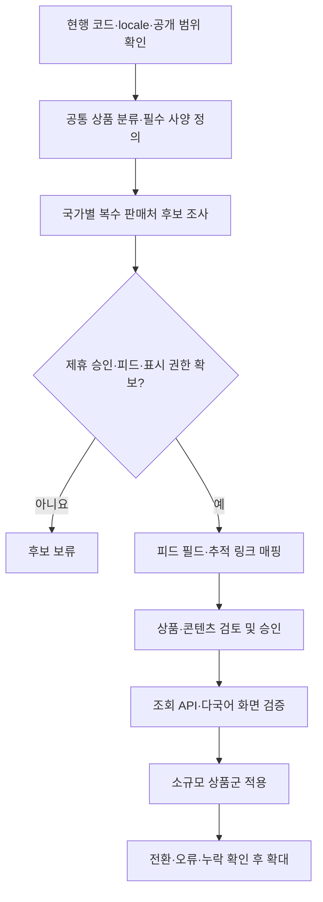
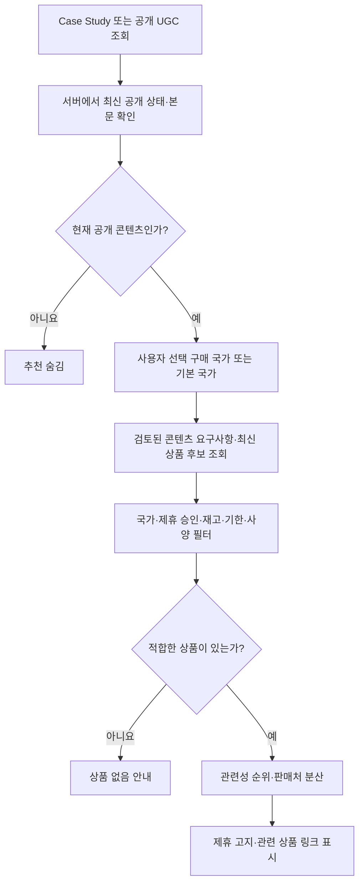

# 다중 판매처 콘텐츠 커머스: 구현 및 적용 계획

2026-10-21 · Smart JSA Bridge · 첫 구현은 기본 비활성화

## 목표와 현재 상태

Case Study 및 공개 UGC의 작업 맥락을 바탕으로 여러 판매처의 관련 상품을 조회 시점에 선택한다. 콘텐츠 업로드 시 상품 ID를 고정하지 않는다. 언어, 작업 현장의 관할 지역, 상품을 구매할 국가는 서로 다른 값으로 취급한다. 각 국가를 단일 판매처에 종속시키지 않는다.

현재 코드에는 공개 콘텐츠 재조회, 다중 판매처 매칭, CSV/JSON 피드 수집, 승인 분리, 상품 검토 지문, 다국어 UI, 구매 국가 선택, 기본 비활성화, 실패 시 추천 숨김이 구현되어 있다. 운영 판매처·상품·승인 목록은 의도적으로 비어 있다. 판매처 가입·심사·API 접근 권한·실제 피드 매핑·정기 작업 실행 환경·카탈로그 호스팅은 아직 연결되지 않았다. 따라서 현재 상태는 검증 가능한 통합 기반이며, 실제 수익이 발생하는 운영 연결 완료 상태는 아니다.

기존 광고 영역과 DB 스키마는 유지한다. 모든 추천은 서버의 공개 읽기 권한만 사용한다. API 키, 사용자 원문 전체, 사적 참여자 정보는 브라우저나 판매처로 보내지 않는다.

## 준비부터 적용까지



| 단계 | 이 변경에서 수행 | 운영 전 필요한 입력 |
|---|---|---|
| 사이트 조사 | 19개 지원 locale, 공개 Case Study/UGC 경로 확인 | 없음 |
| 분류·추천 | 기본 저위험 상품 분류와 검토된 사양 매칭 | 실제 상품별 규격 및 작업 맥락 검토 |
| 판매처 | 국가당 여러 merchant 지원 | 사업자/제휴 계정, 국가별 승인 |
| 상품 수집 | 승인된 HTTPS CSV/JSON 피드 정규화 | 실제 피드 URL, 필드, 재고값, 카테고리 매핑 |
| 추적 링크 | 승인 호스트의 완성된 링크만 표시 | 판매처가 발급한 제휴 링크·필수 고지 |
| 데이터 갱신 | 실행 가능한 CLI, 만료 및 실패 처리 | 스케줄러, 출력 업로드 대상, 장애 알림 |
| 화면 | 공통 컴포넌트·11개 언어·구매 국가 선택 | 실제 상품으로 최종 현지 검수 |
| 배포 | 비활성화 기본값·롤백 스위치·PR 검증 | 운영 검토 후 병합/배포 및 활성화 |

## 조회 시점 처리



조회 때 판매처 API나 유료 AI를 호출하지 않는다. 판매처 피드는 별도 갱신 작업에서 내려받고, 요청에서는 자체 정규화 카탈로그만 읽는다. Vercel의 국가 헤더는 배포 환경에서만 기본값으로 사용하고, 사용자가 선택한 구매 국가를 우선한다. 언어를 바꿔도 작업 현장 규정이나 안전 요구사항을 임의로 바꾸지 않는다.

API는 매 요청 공개 DB를 다시 읽고 응답을 캐시하지 않는다. 이는 비공개 전환 후 새 요청이 추천을 받지 않게 하기 위함이다. 이미 열린 화면을 강제로 실시간 회수하는 기능은 포함하지 않는다. 변경된 콘텐츠 지문은 이전 검토를 무효화한다.

## 파일과 실행

- `api/commerce.js`: GET 전용, 입력 검증, 공개 콘텐츠 재확인, 추천 결과만 반환.
- `server/commerce/source.js`: 공개 콘텐츠 조회 공통 경로.
- `server/commerce/engine.js`: 콘텐츠/상품 지문, 승인 및 적합성 필터, 순위.
- `server/commerce/ingest.js`: CSV/JSON 정규화, HTTPS 피드 다운로드, 판매처별 실패 격리.
- `server/commerce/catalog.js`: 로컬 또는 허용된 원격 카탈로그 로딩.
- `scripts/commerce-refresh.js`: 전체 상품 스냅샷 교체.
- `scripts/commerce-review.js`: 승인 전 검토 패킷 출력.
- `data/commerce/feeds.json`: 피드 매핑; 비밀 URL은 환경 변수로만 참조.
- `data/commerce/governance.json`: 운영자가 관리하는 판매처·상품·콘텐츠 승인.
- `data/commerce/catalog.json`: 배포 가능한 추천용 스냅샷. 초기 빈 상태.
- `src/components/CommerceRecommendations.jsx`: 두 콘텐츠 화면이 공유하는 UI.
- `src/locales/commerceUi.js`: 지원 locale용 표시 문구.
- `scripts/commerce.test.js`: 추천·공개 상태·입력·피드 실패 테스트.

```sh
# 운영 API 없이 검증
node --test scripts/commerce.test.js
npx vite build
# Chrome 또는 PUPPETEER_EXECUTABLE_PATH가 있는 환경: 가상 상품만 사용하는 UI 검사
node scripts/commerce-browser.cjs

# 승인된 피드 설정으로 갱신; 비밀 URL은 서버 환경에만 둔다
node scripts/commerce-refresh.js data/commerce/feeds.json data/commerce/governance.json data/commerce/catalog.json

# 기존 공개 콘텐츠의 검토 지문과 후보를 출력한다
node scripts/commerce-review.js case ACTUAL_CASE_GROUP_ID en-US
node scripts/commerce-review.js ugc ACTUAL_PUBLIC_UUID ko
```

검토 CLI의 결과는 pending이며 승인되지 않는다. 요구 사양·상품 링크·사용 범위를 확인한 사람이 승인 레코드를 governance에 추가한다. 피드에 포함된 reviewer나 approved 필드는 승인으로 가져오지 않는다.

## 판매처 연결 계약

판매처의 제휴 프로그램과 상품 카탈로그 API는 별개다. 공개 API가 있다는 이유만으로 제휴 가입, 상품 표시, 캐시, 다중 판매처 나열이 승인되었다고 가정하지 않는다. 각 계정에서 다음을 확인한 뒤 해당 merchant만 활성화한다.

1. 구매 대상 국가, 해당 국가용 제휴 승인, 지급 가능 여부.
2. 공식 상품 피드/API 접근, 호출 한도, 보관 및 갱신 조건.
3. 재고 표현, 배송 국가, SKU, 정확한 사양, 추적 URL 생성 방식.
4. UGC 옆 노출, 다중 판매처 나열, 이미지·가격 사용 및 필수 고지 조건.
5. 반품/취소 반영 후 실제 승인 수수료. 수수료를 3%로 고정하지 않는다.

Awin은 링크 생성 API를 제공하지만 브라우저 실시간 링크 생성 용도가 아니라고 명시한다. 따라서 승인된 링크를 백그라운드에서 생성·저장하는 구조를 채택했다. Profitshare는 상품 피드와 API를 공개 안내한다. 이는 네트워크 차원의 기능 확인이며, 특정 판매처(예: ManoMano, eMAG, Zoro)의 개별 계정 접근이 확보되었다는 뜻은 아니다.

참고: [Awin 공식 링크 API 안내](https://www.awin.com/gb/how-to-use-awin/link-builder-api), [Profitshare 공식 도구 안내](https://profitshare.ro/resources).

서명 방식이나 OAuth가 필요한 판매처 API는 승인된 계정 문서에 따라 별도 어댑터를 추가해야 한다. 현재 다운로드 모듈은 비밀 환경 변수에 저장된 승인된 HTTPS CSV/JSON 피드 URL을 지원한다. gzip/ZIP/XML/페이지네이션 API는 직접 지원하지 않는다. 실제 샘플을 받은 뒤 정규화 어댑터로 연결한다. 원시 API를 모르는 상태에서 임의의 엔드포인트를 구현하지 않는다.

## 설정 스키마 예시

아래는 설명용 가상 도메인이다. 실제 설정에 복사해 활성화하지 않는다.

```json
{
  "version": 1,
  "merchants": [{
    "id": "approved-supplier-us",
    "name": "Approved supplier",
    "enabled": false,
    "affiliateApproved": false,
    "displayApproved": false,
    "countries": ["US"],
    "linkHosts": ["tracking.example"],
    "maxAgeHours": 6,
    "disclosures": {"en": "Insert the program-required disclosure here"}
  }],
  "reviews": [],
  "profiles": []
}
```

```json
{
  "version": 1,
  "feeds": [{
    "id": "approved-supplier-us-feed",
    "merchantId": "approved-supplier-us",
    "country": "US",
    "urlEnv": "JSA_SUPPLIER_US_FEED_URL",
    "allowedHosts": ["feed.example"],
    "format": "csv",
    "delimiter": ",",
    "fields": {
      "id": "sku",
      "title": "product_name",
      "category": "category",
      "affiliateUrl": "tracking_url",
      "availability": "availability"
    },
    "categories": {"Office/Clipboards": "clipboard"},
    "inStockValues": ["in_stock"],
    "attributes": {"material": "material"}
  }]
}
```

추적 호스트는 상품 판매 도메인과 다를 수 있다. 허용 목록은 실제 발급된 추적 URL의 호스트에 정확히 맞춘다. URL을 임의로 만들거나 쿠키를 심지 않는다.

상품 승인:

```json
{
  "offerFingerprint": "OUTPUT_FROM_REVIEW_TOOL",
  "status": "approved",
  "reviewer": "ACTUAL_REVIEWER",
  "reviewedAt": "ACTUAL_REVIEW_TIME",
  "validUntil": "ACTUAL_REVIEW_EXPIRY",
  "safetyReviewed": false
}
```

콘텐츠별 사양 승인:

```json
{
  "sourceFingerprint": "OUTPUT_FROM_REVIEW_TOOL",
  "status": "approved",
  "reviewer": "ACTUAL_REVIEWER",
  "reviewedAt": "ACTUAL_REVIEW_TIME",
  "validUntil": "ACTUAL_REVIEW_EXPIRY",
  "needs": [{
    "category": "reviewed-category",
    "constraints": {"requiredAttribute": "REVIEWED_EXACT_VALUE"}
  }]
}
```

카테고리·상품 사양·추적 링크·제목이 바뀌면 상품 지문이 달라져 재검토가 필요하다. 재고/확인 시각 갱신만으로는 동일 상품의 검토를 무효화하지 않는다. 검토된 콘텐츠에서 `suppress: true`를 지정하면 해당 버전의 추천을 비활성화한다.

## 추천 기준과 한계

- 최초 자동 추출은 문서에 명시된 클립보드, 문서 보관용품, 공구 보관용품의 제한된 다국어 키워드다. LLM 기반 의미 추출이나 모든 산업용품 자동 분류가 구현된 것은 아니다.
- 이 외 상품은 유효한 콘텐츠 검토, 비어 있지 않은 사양 조건, 별도의 상품 안전 검토가 모두 필요하다.
- 기본 자동 분류도 상품별 승인이 있어야 노출된다. 승인 없는 새 피드 상품은 자동 게시되지 않는다.
- 재고가 명확히 in_stock인 상품만 허용한다. 새 확인 시각은 피드를 수신한 시각이지 물류 시스템을 실시간 확인한 시각이 아니다. 공급 피드 지연을 포함해 적절한 갱신 주기를 정한다.
- 상품은 최대 4개, 판매처당 최대 2개. 사양 일치 수와 정보의 신선도 순으로 정렬하며 수수료율은 순위에 사용하지 않는다.
- 추천 문구는 “관련 상품”이다. 실제 사용 제품, 인증 적합성, 작업 안전 보장으로 표현하지 않는다.
- 초기 카드에는 가격, 상품 이미지, 리뷰 점수, 추정 배송 날짜를 표시하지 않는다. 해당 권한과 데이터 정확성이 확인되면 추가한다.
- API 오류나 카탈로그 오류는 본문과 분리해 추천만 숨긴다. 승인 상품이 없는 국가에는 없음 안내와 국가 선택을 제공한다.
- 제휴 링크 클릭/전환 자체 수집은 이번 변경에 포함하지 않는다. 초기 전환은 판매처 대시보드로 확인하고, 추후 익명 집계는 기존 동의 정책과 연결해 설계한다.

## 운영 활성화 순서

1. 국가별 범용 판매처와 산업 전문 판매처를 후보로 두되, 실제 승인·재고·구매 적합성이 있는 계정부터 연결한다.
2. feeds 및 governance를 작성하고 승인된 환경에 비밀 피드 URL을 설정한다.
3. 갱신 CLI로 원시 상품을 정규화한다. 실제 콘텐츠에 대한 검토 패킷을 만들고 필요한 상품과 요구 사양을 승인한다.
4. 다시 갱신해 승인 정보가 포함된 스냅샷을 생성한다. 운영 환경에 비밀 원본 피드가 아닌 정규화 스냅샷만 제공한다.
5. 작은 시험 상품군으로 locale·구매 국가·링크 추적·품절·만료·UGC 비공개 전환을 점검한다.
6. 검토된 변경을 배포하고 `JSA_COMMERCE_ENABLED=true`를 서버 환경에 설정한다. `VITE_` 접두사를 사용하지 않는다.
7. 로컬 파일 사용은 배포 시 갱신된 파일을 포함해야 한다. 운영 권장 방식은 별도 갱신 작업이 자체 저장소의 스냅샷을 원자적으로 교체하고 아래 두 환경 변수를 지정하는 것이다.
   - `JSA_COMMERCE_CATALOG_URL`: 정규화 JSON의 HTTPS URL.
   - `JSA_COMMERCE_CATALOG_HOST`: 그 URL의 정확한 허용 호스트.
8. 갱신 스케줄은 판매처 약관과 TTL 이내로 설정한다. 실패한 피드 상품을 뺀 새 스냅샷도 게시한 뒤 `failedFeeds`로 운영 알림을 보낸다. 출력은 기존 stale 상품을 합치지 않는다.
9. 긴급 중지는 `JSA_COMMERCE_ENABLED=false` 또는 해당 merchant의 `enabled=false`다. 배포 환경 변수 변경의 재배포 필요 여부를 확인한다.

서버는 원격 카탈로그를 2.5초 이내, 2MB 및 5,000개 이하로 제한한다. 공급 피드는 각 15초·8MB·5,000행 이하이다. 최대 유효 기간은 판매처 설정과 24시간 중 짧은 값이다. 판매처 약관이 더 짧으면 해당 maxAgeHours를 사용한다.

카탈로그가 이 범위를 넘으면 동일 인터페이스를 유지한 채 국가/카테고리별 서버 저장소와 인덱스로 전환한다. 사용자 요청마다 전체 글로벌 피드를 다운로드하는 방식으로 확대하지 않는다. 새 판매처 추가는 어댑터·매핑·승인을 추가하는 작업이며 사용자 화면을 판매처별로 다시 구현하는 작업이 아니다.


## Korea manual-link launch (2026-10-21)

The first catalog uses a portal-issued Coupang product link for an ordinary A4 clipboard. Product titles and links are operator-reviewed; no product image, price, stock promise, PPE suitability or API approval is claimed. `affiliateApproved` describes permission to publish partner links after enrollment; the separate `finalApproval` remains pending and `apiApproved` remains false.

Production uses `JSA_COMMERCE_ENABLED=true` and the server-only `JSA_COMMERCE_CATALOG_JSON`. The tracking URL is held in hosting configuration, not public Git. This catalog overrides the empty checked-in catalog. Existing remote feed support remains unchanged.

Manual offers use `mode: link-only`, unknown availability, a merchant opt-in (`linkOnlyApproved`), low-risk categories only, and independent dated product review. They expire no later than 30 days from `checkedAt`; normal feed offers retain their 24-hour maximum. Refreshing a deployment does not refresh review dates. The initial review expires on 2026-11-20 and must be rechecked before then.

A4 clipboards can match explicit clipboard mentions or checklist/inspection-sheet paperwork. The panel explicitly calls these related suggestions, not products used in the case. No matching product means no initial panel. Country is determined by the visitor's explicit selection, trusted Vercel country, then locale. English content viewed from Korea can therefore display Korean purchase links. Other countries do not receive this KR offer.


## Contextual accessories and support rails (2026-10-22)

Case-study and public-UGC pages replace the advertising slots with document/reuse and discovery links on the left and contextual commerce on the right. At widths below 1740 px, the same commerce component stays inline. Home slots lead to document creation and content discovery.

Ordinary accessory needs are derived from the current content on retrieval. Work-specific needs rank ahead of document supplies; one product per merchant/category and at most four per merchant are selected. PPE, rated equipment and process-compatible parts retain the existing explicit-review requirement. No match means no placeholder advertisement.

The production catalog is maintained in the server-only JSA_COMMERCE_CATALOG_JSON setting. It contains 13 manually generated Coupang product links, with unknown availability and no price claims. Link reviews expire after 30 days; no API approval is implied. Tracking URLs and account identifiers must not be committed.

Corpus audit: 199 Korean case studies plus 50 public UGC entries; 230 match at least two products, 85 match four, seven match one and 12 remain empty. Across 1,472 localized case variants and 50 UGC entries, using KR as the purchase country, 1,338 match multiple products, 127 match one and 57 remain empty. These are localized page counts, not distinct tasks or overseas merchant coverage. Reproduce with scripts/audit-commerce-corpus.mjs and private input/catalog paths.

Validation: 524 Node tests pass; Vite production bundle builds. The commerce workflow also executes the accessory relevance tests.
